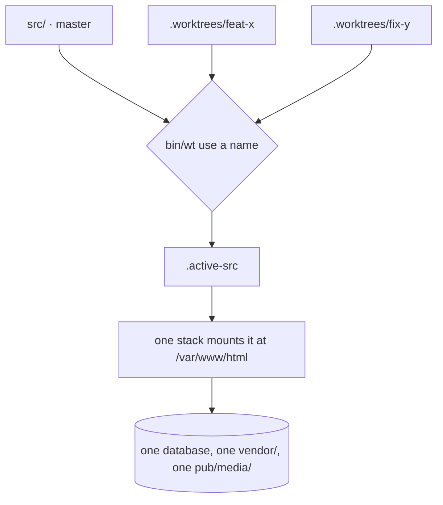
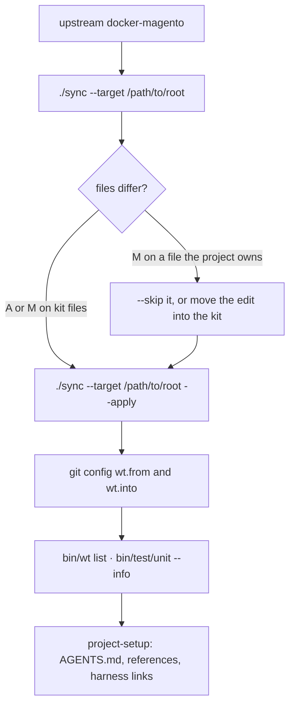
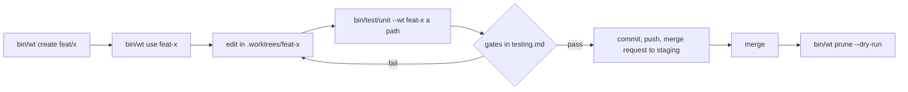
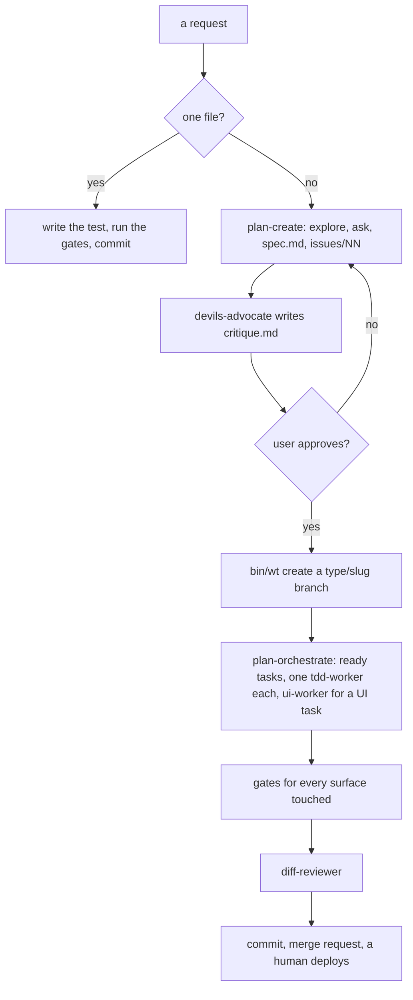
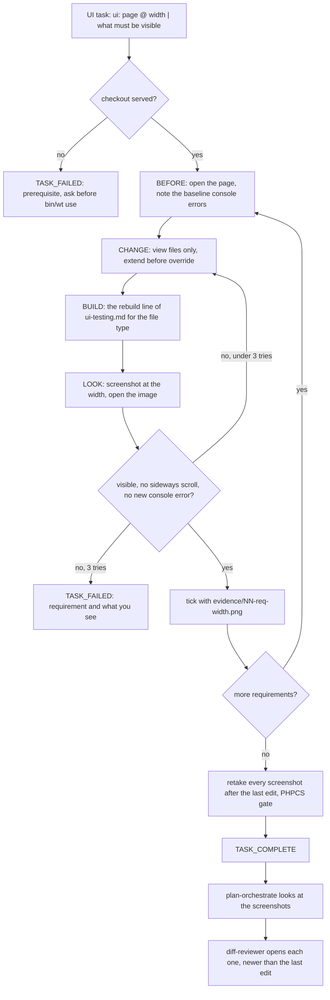

# magento-docker-kit

[English](README.md) | [Tiếng Việt](README.vi.md)

A small overlay for a [markshust/docker-magento](https://github.com/markshust/docker-magento) Docker
root. One stack serves many Git worktrees, one runner runs the unit tests, four skills and five roles
carry the agent workflow. Docker comes from upstream, `sync` copies the overlay, and the project
writes its own `AGENTS.md`. There is no installer, no profile file and no generated configuration.

## Start here

Read in this order:

1. **[The picture](#the-picture)** — 30 seconds.
2. **[Set up a project](#set-up-a-project)** — once per Docker root.
3. **[The daily loop](#the-daily-loop)** — every branch you work on.
4. **[The agent workflow](#the-agent-workflow)** — for a feature or a change across several files.
5. **Reference** — [commands](#the-daily-loop), [tests](#unit-tests), [hooks](#hooks),
   [troubleshooting](#troubleshooting).

| You want to | Go to |
|---|---|
| put the kit on a Docker root | [Set up a project](#set-up-a-project) |
| start a branch and see it in the browser | [The daily loop](#the-daily-loop) |
| let an agent plan and implement a feature | [The agent workflow](#the-agent-workflow) |
| run one test the way an agent does | [Unit tests](#unit-tests) |
| understand the three hooks | [Hooks](#hooks) |
| fix a 404, a parallel run or a drift reminder | [Troubleshooting](#troubleshooting) |

## The picture

The kit is a source tree. `sync` copies it into a Docker root: the Docker tooling at the root, the
agent layer into `src/`, the main checkout. `src/` is the Git repository and the directory a harness
is opened in. The project keeps its own facts there, in `AGENTS.md` and its references.

```text
kit                                  Docker root
├── sync ───────────────────────────▶
├── docker/  ───────────────────────▶ bin/wt, bin/test/unit, bin/phpcs, compose.worktree.yaml
└── agents/  ───────────────────────▶ src/.agents/skills, src/.agents/agents, src/.agents/hooks

Docker root                          Git
├── src/            main checkout ──▶ the Magento repository, branch master, the agent root
├── .worktrees/     one per branch
└── .active-src ──▶ one of them      what the stack mounts at /var/www/html
```

One stack, many checkouts. Switching a checkout restarts `app` and `phpfpm` only: the database,
Redis, OpenSearch and the queue keep running.



Words used below:

| Word | Means |
|---|---|
| Docker root | the directory with `compose.yaml` and `bin/`. It is not a Git repository |
| checkout | `src/` or a directory in `.worktrees/`. A Magento root on its own branch |
| agent root | `src/`, the main checkout. A harness is opened here, and `AGENTS.md`, `.agents/`, `.claude/` and `.scratch/` live here |
| served checkout | the one `.active-src` points at. It is what the stack runs |

## Set up a project

Upstream first, then three steps. The `project-setup` skill walks them with you.



```bash
./sync --target /path/to/docker-root          # A = missing, M = different
./sync --target /path/to/docker-root --apply  # copy it
git -C /path/to/docker-root/src config wt.from origin/master    # base of new worktrees
git -C /path/to/docker-root/src config wt.into origin/staging   # target used by prune
```

- `sync` only adds and updates. It never deletes, so a file the kit drops is removed in the project
  by hand. A file you changed shows as `M`: decide per file instead of applying blindly.
- `--skip <path>` leaves one file alone, for a file the project owns itself. A Docker root that
  already has its own `compose.worktree.yaml` or `bin/docker-compose` needs this until the two
  versions are reconciled.
- The overlay covers `app` and `phpfpm`. Upstream's `phpfpm-xdebug` still mounts `./src`, so
  `--xdebug` runs against `src/`, not the active worktree. The runner says so in `--info`.
- `wt.from` and `wt.into` live in `src/.git/config`. They are not committed and can be replaced per
  call with `--from` and `--into`. Without either, `bin/wt` stops and says how to set them.
- `bin/` stays in the Docker root, one level above the agent root: from `src/` the commands below
  are `../bin/wt`, `../bin/test/unit` and so on.

The project layer is yours to write, in `src/`:

```text
CLAUDE.md                -> AGENTS.md
.claude/skills           -> ../.agents/skills
.claude/agents/<role>.md -> ../../.agents/agents/<role>.md
AGENTS.md                                   the single source: boundaries, commands, Git rules
project/agent/references/architecture.md    layout, commands, checkouts
project/agent/references/testing.md         test command, gate matrix, evidence
project/agent/references/code-standards.md  the standard, review checks
project/agent/references/ui-testing.md      rebuild commands, pages, login, widths, screenshots
```

Keep the layer out of Git with `src/.gitignore` or `src/.git/info/exclude`, unless the project
commits it.

A worktree does not carry ignored files, so `bin/wt create`, `prepare` and `use` link the layer of
`src/` into it. A harness opened in a worktree then has the same instructions, skills, roles, hooks,
references and plans as one opened in `src/`:

```text
.worktrees/feat-x/AGENTS.md  -> <Docker root>/src/AGENTS.md
.worktrees/feat-x/.agents    -> <Docker root>/src/.agents
.worktrees/feat-x/.scratch   -> <Docker root>/src/.scratch
```

- Linked when `src/` has them: `AGENTS.md`, `CLAUDE.md`, `.agents`, `.claude`, `.codex`, `.omp`,
  `project`, `.scratch`.
- A project adds its own paths, one per call: `git -C src config --add wt.link docs`.
- It is one shared copy: an edit or a delete through the link changes the file in `src/`.
- A path the worktree already has is left alone, so a branch that tracks its own copy keeps it.
- A link Git would not ignore is added to `info/exclude`, so it is never staged.
- The links are absolute. After moving the Docker root, delete them and run `bin/wt prepare <name>`.

A harness with agent types (Claude Code `.claude/agents`, OMP `.omp/agents`) calls a role by name.
Every other harness reads `.agents/agents/<role>.md`, drops the frontmatter and passes the body to
its subagent tool. `agents/skills/project-setup/references/examples/magento/` is the worked example
for the four references and the UI rules file the hook injects.

## The daily loop



```bash
bin/wt create feat/checkout-rework   # new branch from wt.from (or --from <remote>/<branch>)
bin/wt use feat-checkout-rework      # the stack now serves that worktree, app and phpfpm restart
bin/wt status                        # the served checkout: run it before any Magento command
bin/wt list | path <name> | shell <name>
bin/wt run <name> <command...>       # run a command for that checkout in a throwaway container
bin/wt prepare <name>                # copy the core files a fresh checkout lacks
bin/wt prune --dry-run               # merged into wt.into (or --into) and review worktrees
bin/wt doctor                        # compare the phpfpm mount with .active-src
```

`bin/wt` is the only way to create and switch checkouts. Never edit `.active-src`, never run
`git worktree add` for this. One database is shared, so a schema change or a `composer install`
affects every checkout: tell the user before `setup:upgrade`.

## The agent workflow



| Skill | When |
|---|---|
| `plan-create` | a feature or a change across several files, planned with the user |
| `plan-orchestrate` | an approved plan: tasks in order, gates, review, commit |
| `project-setup` | once per project, or when adopting an existing Docker root |
| `project-update` | the kit changed: report the drift, copy on approval, check `AGENTS.md` |

| Role | Does |
|---|---|
| `code-researcher` | answers one question with `path:line` evidence, read only |
| `devils-advocate` | critiques the plan before any code, fixes the task files |
| `tdd-worker` | implements one task file, RED then GREEN per requirement |
| `ui-worker` | implements one UI task file, a screenshot per `ui:` requirement |
| `standards-enforcer` | fixes standards without changing behavior, off by default |
| `diff-reviewer` | reviews the diff before a commit, read only |

## UI tests

What a user sees is a `ui:` requirement, proved by a screenshot, never by reading the code. One
`ui-worker` runs per UI task, alone, because one checkout is served at a time.



- The rebuild table, the page, the login, the widths and the pass rule live in the project's
  `project/agent/references/ui-testing.md`. The platform rules the hook injects live in the UI
  rules file (`docs/agents/ui-conventions.md` in the example).
- A screenshot passes when it shows what the requirement says at that width, the page does not
  scroll sideways, and the console has no error the page did not have before the change.
- Evidence belongs to the last revision: any later edit makes every screenshot stale.

## Unit tests

```bash
bin/test/unit --info                                 # what the runner will do: read this first
bin/test/unit <path> --filter <regex>                # serial, on the served checkout
bin/test/unit --parallel <path>                      # ParaTest
bin/test/unit --wt <name> [--parallel] <path>        # throwaway container (what agents use)
bin/test/unit --xdebug <path>                        # through upstream bin/debug-cli
bin/test/unit --coverage <path>                      # HTML report in dev/tests/unit/report
```

- The command comes from the project's composer scripts `test:unit` and `test:unit:parallel`.
  Without them: `vendor/bin/phpunit` and `vendor/bin/paratest -p ${TEST_PROCESSES:-2}` with
  `dev/tests/unit/phpunit.xml.dist`.
- `--parallel` without ParaTest exits 2 with the install command. It never falls back to serial.
- `--wt` always uses a new container: same image as `phpfpm`, no network, checkout and shared
  `vendor/` read-only, tmpfs for `generated/`, `var/` and `dev/tests/unit`. Several runs at once
  never share those directories. A `composer.lock` that differs from the served checkout's, the lock
  the shared `vendor/` follows, stops the run.
- Exit code 2 is a usage or prerequisite error, anything else is the tests' exit code.

## Hooks

Three hooks, one script each. They take their arguments on the command line, so there is no registry
to keep.

```text
Edit or Write ─▶ ui-conventions.sh <rules path>   a UI file? inject the project's rules, once
              └▶ guard-paths.sh                   build output? deny. src/ on master? remind

Session start ─▶ kit-drift.sh <kit path> [skip…]  behind the kit? one line, with the skill to run
```

The hooks find `src/` from their own location, `src/.agents/hooks/`, so they answer the same in a
harness opened in `src/` and in one opened in a worktree. `ui-conventions.sh` reads the rules file
from the edited checkout, else from `src/`, and warns on stderr when it is missing. `guard-paths.sh`
denies a write into `vendor/`, `generated/` or `pub/static/`, because build output is never edited by
hand, and reminds on a write to a file in `src/` that Git does not ignore while `src/` is on `master`
or `staging`. `kit-drift.sh` runs `sync` against the parent of `src/` and stays silent when the
project is in sync, when the kit path is wrong and on a usage error.

```json
{
  "hooks": {
    "PreToolUse": [{
      "matcher": "Edit|Write|MultiEdit",
      "hooks": [
        { "type": "command", "timeout": 10,
          "command": "\"$CLAUDE_PROJECT_DIR\"/.agents/hooks/ui-conventions.sh docs/agents/ui-conventions.md" },
        { "type": "command", "timeout": 10,
          "command": "\"$CLAUDE_PROJECT_DIR\"/.agents/hooks/guard-paths.sh" }
      ]
    }],
    "SessionStart": [{
      "matcher": "startup|resume|clear",
      "hooks": [{ "type": "command", "timeout": 15,
        "command": "\"$CLAUDE_PROJECT_DIR\"/.agents/hooks/kit-drift.sh /path/to/kit compose.worktree.yaml" }]
    }]
  }
}
```

## Troubleshooting

| Symptom | Cause | Fix |
|---|---|---|
| 404 right after `bin/wt use` | the fresh checkout lacks untracked core files | `bin/wt prepare <name>` |
| a test run exits 2 | usage or prerequisite, often a `composer.lock` mismatch | read the message, the user decides whether to serve the checkout or merge the base branch |
| `--parallel` says unavailable | ParaTest is not installed | a project decision: `bin/composer require --dev brianium/paratest` |
| serial passes, parallel fails | shared state between tests | find it, or mark the suite serial with the evidence |
| the stack serves the wrong code | `.active-src` and the mount disagree | `bin/wt doctor`, then `bin/wt use <name>` |
| a drift reminder at session start | the project is behind the kit | run the `project-update` skill |

## What is in it

| Path | Purpose |
|---|---|
| `sync` | Copy the overlay into a Docker root, or report what drifted |
| `docker/bin/wt` | Create, switch and clean worktrees. One stack, one database, one `vendor/` |
| `docker/compose.worktree.yaml` | Overlay that mounts `.active-src`, the served checkout |
| `docker/bin/docker-compose` | Upstream file plus one block that loads the overlay when `.active-src` is a symlink |
| `docker/bin/test/unit` | The one unit test runner: serial, `--parallel`, `--wt`, `--xdebug`, `--coverage` |
| `docker/bin/phpcs` | Upstream file plus `--wt <name>` |
| `docker/bin/watch` | Frontend watcher that follows `.active-src` |
| `docker/conf/php/opcache.ini` | OPcache settings for development |
| `agents/skills/` | Four skills: `plan-create`, `plan-orchestrate`, `project-update`, `project-setup` |
| `agents/agents/` | Six roles: `code-researcher`, `devils-advocate`, `tdd-worker`, `ui-worker`, `standards-enforcer`, `diff-reviewer` |
| `agents/hooks/` | Three hooks: `ui-conventions.sh`, `guard-paths.sh`, `kit-drift.sh` |

## Tests

```bash
bash tests/run-all.sh
```

The tests need bash, git and jq. Docker is replaced by a fake that logs its calls.

## Inspired by

The workflow layer takes its shape from [hcf](https://github.com/markshust/hcf) by
[Mark Shust](https://github.com/markshust), MIT, Copyright (c) Devtomic LLC: plans as tasks whose
requirements are test names, a critique before any code, and one role per step. Two of the hooks
follow small patterns from hcf, a session-start heads-up and a PreToolUse deny. This kit keeps the
small part and leaves hcf's eight hook points, its agent enrollment and its plan schema behind.

The Docker stack is [markshust/docker-magento](https://github.com/markshust/docker-magento), also by
Mark Shust. Two overlay files are modified copies of it, as `NOTICE` says.
