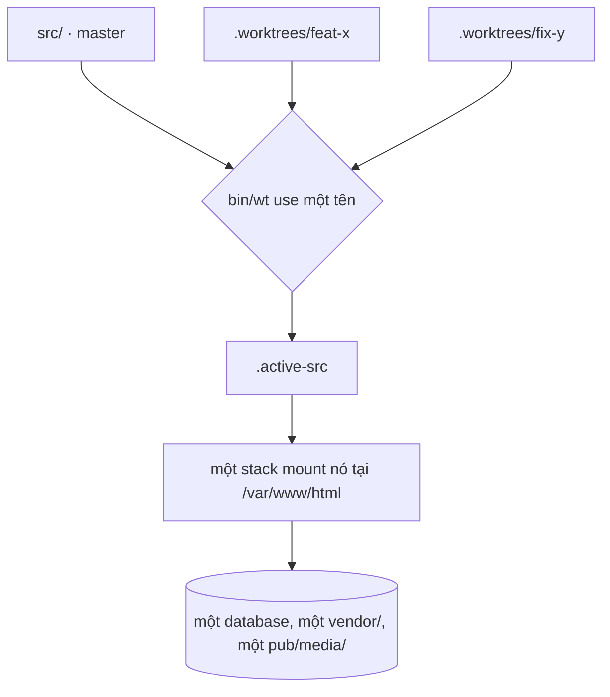
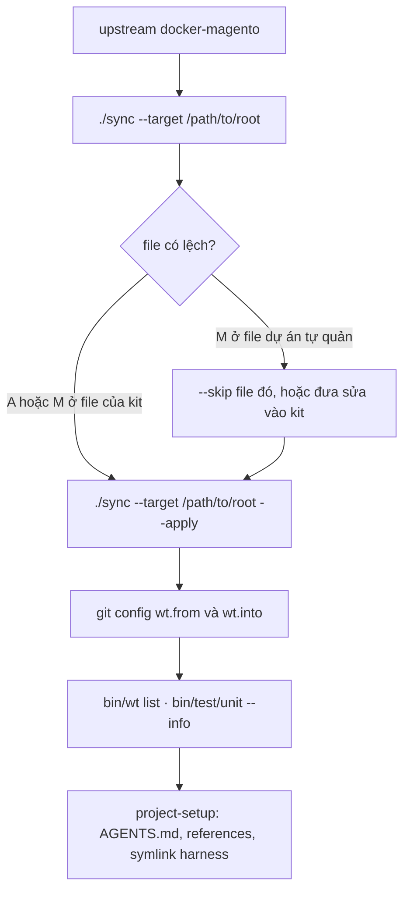
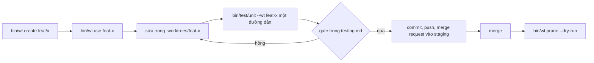
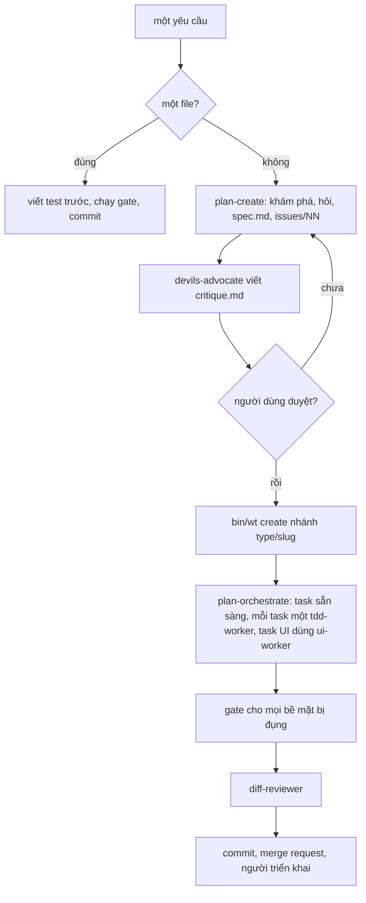
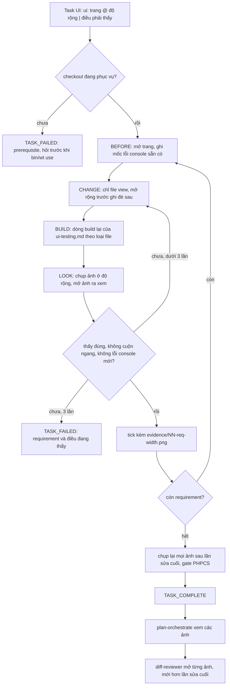

# magento-docker-kit

[English](README.md) | [Tiếng Việt](README.vi.md)

Một lớp phủ nhỏ cho Docker root dựng bằng [markshust/docker-magento](https://github.com/markshust/docker-magento).
Một stack phục vụ nhiều Git worktree, một runner unit test, bốn skill và năm role cho agent.
Docker lấy từ upstream, `sync` chép lớp phủ, dự án tự viết `AGENTS.md`.
Không có installer, không có file profile, không có cấu hình sinh tự động.

## Bắt đầu từ đây

Đọc theo thứ tự:

1. **[Bức tranh](#bức-tranh)** — 30 giây.
2. **[Dựng một dự án](#dựng-một-dự-án)** — một lần cho mỗi Docker root.
3. **[Vòng lặp hằng ngày](#vòng-lặp-hằng-ngày)** — mỗi nhánh bạn làm.
4. **[Quy trình agent](#quy-trình-agent)** — khi là tính năng hoặc thay đổi nhiều file.
5. **Tra cứu** — [lệnh](#vòng-lặp-hằng-ngày), [test](#unit-test), [hook](#hook),
   [xử lý sự cố](#xử-lý-sự-cố).

| Bạn muốn | Đọc mục |
|---|---|
| đưa kit vào một Docker root | [Dựng một dự án](#dựng-một-dự-án) |
| mở nhánh mới và xem trên trình duyệt | [Vòng lặp hằng ngày](#vòng-lặp-hằng-ngày) |
| để agent lập kế hoạch và làm một tính năng | [Quy trình agent](#quy-trình-agent) |
| chạy một test giống cách agent chạy | [Unit test](#unit-test) |
| hiểu ba hook | [Hook](#hook) |
| sửa 404, lỗi chạy song song hay nhắc lệch kit | [Xử lý sự cố](#xử-lý-sự-cố) |

## Bức tranh

Kit là một cây nguồn. `sync` chép nó vào một Docker root: công cụ Docker nằm ở gốc, lớp agent nằm
trong `src/`, tức checkout chính. `src/` là repository Git và là thư mục mở harness. Dự án giữ sự
thật của mình ở đó, trong `AGENTS.md` và các reference.

```text
kit                                  Docker root
├── sync ───────────────────────────▶
├── docker/  ───────────────────────▶ bin/wt, bin/test/unit, bin/test/ui-regression, bin/phpcs, compose.worktree.yaml
└── agents/  ───────────────────────▶ src/.agents/skills, src/.agents/agents, src/.agents/hooks

Docker root                          Git
├── src/            checkout chính ─▶ repository Magento, nhánh master, gốc agent
├── .worktrees/     mỗi nhánh một thư mục
└── .active-src ──▶ một trong số đó  thứ stack mount tại /var/www/html
```

Một stack, nhiều checkout. Chuyển checkout chỉ khởi động lại `app` và `phpfpm`, còn database,
Redis, OpenSearch và queue vẫn chạy.



Vài từ dùng trong tài liệu:

| Từ | Nghĩa |
|---|---|
| Docker root | thư mục có `compose.yaml` và `bin/`. Đây không phải repository Git |
| checkout | `src/` hoặc một thư mục trong `.worktrees/`. Một gốc Magento trên nhánh riêng |
| gốc agent | `src/`, tức checkout chính. Harness mở ở đây, và `AGENTS.md`, `.agents/`, `.claude/`, `.scratch/` nằm ở đây |
| checkout đang phục vụ | checkout mà `.active-src` trỏ tới. Stack chạy chính nó |

## Dựng một dự án

Dựng bằng upstream trước, rồi ba bước. Skill `project-setup` đi cùng bạn từng bước.



```bash
./sync --target /path/to/docker-root          # A = thiếu, M = khác
./sync --target /path/to/docker-root --apply  # chép
git -C /path/to/docker-root/src config wt.from origin/master    # nhánh gốc cho worktree mới
git -C /path/to/docker-root/src config wt.into origin/staging   # nhánh đích cho prune
```

- `sync` chỉ thêm và cập nhật, không bao giờ xóa. File kit bỏ thì xóa trong dự án bằng tay.
  File bạn đã sửa hiện ra là `M`: quyết từng file thay vì chép đè hàng loạt.
- `--skip <path>` để yên một file dự án tự quản. Docker root đã có `compose.worktree.yaml` hoặc
  `bin/docker-compose` riêng thì cần cờ này cho tới khi đối chiếu xong hai bản.
- Overlay phủ `app` và `phpfpm`. Service `phpfpm-xdebug` của upstream vẫn mount `./src`, nên
  `--xdebug` chạy trên `src/`, không phải checkout đang phục vụ. `--info` nói rõ điều đó.
- `wt.from` và `wt.into` nằm trong `src/.git/config`, không commit, thay theo từng lệnh bằng
  `--from` và `--into`. Thiếu cả hai thì `bin/wt` dừng và chỉ cách đặt.
- `bin/` vẫn nằm ở Docker root, trên gốc agent một cấp: từ `src/` các lệnh bên dưới là
  `../bin/wt`, `../bin/test/unit` và tương tự.

Lớp dự án là phần bạn viết, trong `src/`:

```text
CLAUDE.md                -> AGENTS.md
.claude/skills           -> ../.agents/skills
.claude/agents/<role>.md -> ../../.agents/agents/<role>.md
AGENTS.md                                   nguồn duy nhất: ranh giới, lệnh, luật Git
project/agent/references/architecture.md    bố cục, lệnh, checkout
project/agent/references/testing.md         lệnh test, ma trận gate, bằng chứng
project/agent/references/code-standards.md  chuẩn code, các điểm review
project/agent/references/ui-testing.md      lệnh build lại, trang, đăng nhập, độ rộng, ảnh chụp
```

Giữ lớp này ngoài Git bằng `src/.gitignore` hoặc `src/.git/info/exclude`, trừ khi dự án commit nó.

Worktree không mang theo file bị ignore, nên `bin/wt create`, `prepare` và `use` link lớp của `src/`
vào worktree. Harness mở trong worktree khi đó có cùng chỉ dẫn, skill, role, hook, reference và plan
như khi mở ở `src/`:

```text
.worktrees/feat-x/AGENTS.md  -> <Docker root>/src/AGENTS.md
.worktrees/feat-x/.agents    -> <Docker root>/src/.agents
.worktrees/feat-x/.scratch   -> <Docker root>/src/.scratch
```

- Được link khi `src/` có: `AGENTS.md`, `CLAUDE.md`, `.agents`, `.claude`, `.codex`, `.omp`,
  `project`, `.scratch`.
- Dự án thêm đường dẫn riêng, mỗi lần một cái: `git -C src config --add wt.link docs`.
- Chỉ có một bản dùng chung: sửa hay xóa qua link là đổi file trong `src/`.
- Đường dẫn worktree đã có sẵn thì để yên, nên nhánh track bản riêng vẫn giữ bản đó.
- Link mà Git không ignore được thêm vào `info/exclude`, nên không bao giờ bị stage.
- Link là đường dẫn tuyệt đối. Sau khi chuyển Docker root, xóa chúng rồi chạy `bin/wt prepare <name>`.

Harness có agent type (Claude Code `.claude/agents`, OMP `.omp/agents`) gọi role theo tên. Harness
khác đọc `.agents/agents/<role>.md`, bỏ frontmatter rồi đưa phần thân cho subagent tool.
`agents/skills/project-setup/references/examples/magento/` là ví dụ cho bốn file references và file
quy tắc UI mà hook chèn vào.

## Vòng lặp hằng ngày



```bash
bin/wt create feat/checkout-rework   # nhánh mới từ wt.from (hoặc --from <remote>/<branch>)
bin/wt use feat-checkout-rework      # stack chuyển sang worktree đó, chỉ app và phpfpm khởi động lại
bin/wt status                        # checkout đang phục vụ: chạy trước mọi lệnh Magento
bin/wt list | path <name> | shell <name>
bin/wt run <name> <command...>       # chạy một lệnh cho checkout đó trong container dùng một lần
bin/wt prepare <name>                # chép các file lõi mà checkout mới còn thiếu
bin/wt prune --dry-run               # worktree đã merge vào wt.into (hoặc --into) và worktree review
bin/wt doctor                        # so mount của phpfpm với .active-src
```

`bin/wt` là cách duy nhất tạo và chuyển checkout. Không sửa tay `.active-src`, không dùng
`git worktree add` cho việc này. Database dùng chung, nên một thay đổi schema hay một lần
`composer install` ảnh hưởng mọi checkout: báo người dùng trước khi chạy `setup:upgrade`.

## Quy trình agent



| Skill | Khi nào |
|---|---|
| `plan-create` | tính năng hoặc thay đổi nhiều file, lập kế hoạch cùng người dùng |
| `plan-orchestrate` | kế hoạch đã duyệt: task theo thứ tự, gate, review, commit |
| `project-setup` | một lần cho mỗi dự án, hoặc khi nhận một Docker root có sẵn |
| `project-update` | kit đã đổi: báo phần lệch, chép khi được duyệt, kiểm `AGENTS.md` |

| Role | Việc |
|---|---|
| `code-researcher` | trả lời một câu hỏi kèm bằng chứng `path:line`, chỉ đọc |
| `devils-advocate` | phê bình kế hoạch trước khi có code, sửa lại task file |
| `tdd-worker` | làm một task file, RED rồi GREEN cho từng requirement |
| `ui-worker` | làm một task UI, mỗi requirement `ui:` một ảnh chụp |
| `standards-enforcer` | sửa chuẩn code mà không đổi hành vi, mặc định tắt |
| `diff-reviewer` | review diff trước khi commit, chỉ đọc |

## Test UI

Thứ người dùng nhìn thấy là requirement `ui:`, chứng minh bằng ảnh chụp, không bao giờ bằng việc
đọc code. Mỗi task UI một `ui-worker`, chạy một mình vì một lúc chỉ phục vụ một checkout.



- Bảng build lại, trang, đăng nhập, độ rộng và tiêu chí đạt nằm trong
  `project/agent/references/ui-testing.md` của dự án. Quy tắc nền tảng mà hook chèn vào nằm trong
  file quy tắc UI (`docs/agents/ui-conventions.md` ở ví dụ).
- Ảnh đạt khi cho thấy đúng điều requirement nói ở độ rộng đó, trang không cuộn ngang, và console
  không có lỗi mà trang chưa có trước khi sửa.
- Bằng chứng thuộc về bản sửa cuối: sửa thêm là mọi ảnh cũ hết hiệu lực.
- Ngoài requirement, dự án có thể giữ một bộ hồi quy Playwright Test trong
  `dev/tests/ui-regression/`: mỗi trang chính và độ rộng một spec `toHaveScreenshot()`, so với
  baseline đã commit. `bin/test/ui-regression` chạy bộ này trong image Playwright chính thức đúng
  phiên bản suite ghim, trên checkout đang phục vụ, một worker. Bộ này chạy khi đổi style hoặc
  layout dùng chung. Agent không bao giờ tự cập nhật baseline: người dùng duyệt.

## Unit test

```bash
bin/test/unit --info                                 # runner sẽ làm gì: đọc trước
bin/test/unit <path> --filter <regex>                # serial, trên checkout đang phục vụ
bin/test/unit --parallel <path>                      # ParaTest
bin/test/unit --wt <name> [--parallel] <path>        # container dùng một lần (agent dùng cách này)
bin/test/unit --xdebug <path>                        # qua bin/debug-cli của upstream
bin/test/unit --coverage <path>                      # báo cáo HTML trong dev/tests/unit/report
```

- Lệnh lấy từ composer script `test:unit` và `test:unit:parallel` của dự án. Không có thì dùng
  `vendor/bin/phpunit` và `vendor/bin/paratest -p ${TEST_PROCESSES:-2}` với
  `dev/tests/unit/phpunit.xml.dist`.
- `--parallel` mà không có ParaTest thì exit 2 kèm lệnh cài. Không bao giờ tự lùi về serial.
- `--wt` luôn tạo container mới: cùng image với `phpfpm`, không mạng, checkout và `vendor/` dùng chung
  ở chế độ chỉ đọc, tmpfs cho `generated/`, `var/` và `dev/tests/unit`. Nhiều lượt chạy cùng lúc
  không dùng chung các thư mục đó. `composer.lock` khác lock của checkout đang phục vụ, tức lock mà
  `vendor/` dùng chung đang theo, thì dừng.
- Exit 2 là lỗi cách dùng hoặc thiếu điều kiện, mã khác là mã thoát của test.

## Hook

Ba hook, mỗi cái một script. Tham số truyền trên dòng lệnh, nên không có registry để giữ.

```text
Edit hoặc Write ─▶ ui-conventions.sh <đường dẫn quy tắc>  file giao diện? chèn quy tắc một lần
                └▶ guard-paths.sh                         thư mục build? chặn. src/ trên master? nhắc

Mở phiên ────────▶ kit-drift.sh <đường dẫn kit> [skip…]  lệch kit? một dòng kèm skill cần chạy
```

Hook tìm `src/` từ chính vị trí của nó, `src/.agents/hooks/`, nên trả lời giống nhau khi harness mở ở
`src/` và khi mở trong worktree. `ui-conventions.sh` đọc file quy tắc trong checkout đang sửa, nếu
không có thì trong `src/`, và cảnh báo ra stderr khi thiếu. `guard-paths.sh` chặn ghi vào `vendor/`,
`generated/`, `pub/static/`, vì thư mục build không bao giờ sửa tay, và nhắc khi ghi vào một file
trong `src/` mà Git không ignore lúc `src/` đang ở `master` hoặc `staging`. `kit-drift.sh` chạy
`sync` với thư mục cha của `src/`, im lặng khi dự án khớp, khi đường dẫn kit sai, và khi sync báo lỗi
cách dùng.

```json
{
  "hooks": {
    "PreToolUse": [{
      "matcher": "Edit|Write|MultiEdit",
      "hooks": [
        { "type": "command", "timeout": 10,
          "command": "\"$CLAUDE_PROJECT_DIR\"/.agents/hooks/ui-conventions.sh docs/agents/ui-conventions.md" },
        { "type": "command", "timeout": 10,
          "command": "\"$CLAUDE_PROJECT_DIR\"/.agents/hooks/guard-paths.sh" }
      ]
    }],
    "SessionStart": [{
      "matcher": "startup|resume|clear",
      "hooks": [{ "type": "command", "timeout": 15,
        "command": "\"$CLAUDE_PROJECT_DIR\"/.agents/hooks/kit-drift.sh /path/to/kit compose.worktree.yaml" }]
    }]
  }
}
```

## Xử lý sự cố

| Hiện tượng | Nguyên nhân | Cách sửa |
|---|---|---|
| 404 ngay sau `bin/wt use` | checkout mới thiếu các file lõi không được track | `bin/wt prepare <name>` |
| một lượt test exit 2 | lỗi cách dùng hoặc thiếu điều kiện, thường là `composer.lock` lệch | đọc thông báo, người dùng quyết định phục vụ checkout đó hay merge nhánh gốc |
| `--parallel` báo unavailable | chưa cài ParaTest | quyết định của dự án: `bin/composer require --dev brianium/paratest` |
| serial qua, parallel hỏng | test dùng chung state | tìm chỗ dùng chung, hoặc đánh dấu suite chỉ chạy serial kèm bằng chứng |
| stack chạy sai code | `.active-src` và mount lệch nhau | `bin/wt doctor`, rồi `bin/wt use <name>` |
| mở phiên có nhắc lệch kit | dự án đang sau kit | chạy skill `project-update` |

## Gồm những gì

| Đường dẫn | Công dụng |
|---|---|
| `sync` | Chép lớp phủ vào một Docker root, hoặc báo phần đã lệch |
| `docker/bin/wt` | Tạo, chuyển và dọn worktree. Một stack, một database, một `vendor/` |
| `docker/compose.worktree.yaml` | Overlay mount `.active-src`, tức checkout đang phục vụ |
| `docker/bin/docker-compose` | File của upstream, thêm một khối nạp overlay khi `.active-src` là symlink |
| `docker/bin/test/unit` | Runner unit test duy nhất: serial, `--parallel`, `--wt`, `--xdebug`, `--coverage` |
| `docker/bin/test/ui-regression` | Runner bộ ảnh chụp: Playwright Test trong image chính thức của phiên bản đã ghim, checkout đang phục vụ, một worker, `--update` |
| `docker/bin/phpcs` | File của upstream, thêm `--wt <name>` |
| `docker/bin/watch` | Watcher frontend đi theo `.active-src` |
| `docker/conf/php/opcache.ini` | Cấu hình OPcache cho môi trường dev |
| `agents/skills/` | Bốn skill: `plan-create`, `plan-orchestrate`, `project-update`, `project-setup` |
| `agents/agents/` | Sáu role: `code-researcher`, `devils-advocate`, `tdd-worker`, `ui-worker`, `standards-enforcer`, `diff-reviewer` |
| `agents/hooks/` | Ba hook: `ui-conventions.sh`, `guard-paths.sh`, `kit-drift.sh` |

## Test

```bash
bash tests/run-all.sh
```

Test cần bash, git và jq. Docker được thay bằng bản giả ghi lại lời gọi.

## Tham khảo từ

Lớp quy trình lấy hình mẫu từ [hcf](https://github.com/markshust/hcf) của
[Mark Shust](https://github.com/markshust), giấy phép MIT, Copyright (c) Devtomic LLC: kế hoạch chia
thành task với requirement là tên test, phê bình trước khi viết code, và mỗi bước một role. Hai hook
theo hai mẫu nhỏ của hcf, một dòng nhắc lúc mở phiên và một lần chặn ở PreToolUse. Kit giữ phần nhỏ
và bỏ lại tám hook point, cơ chế enrollment theo agent và schema plan của hcf.

Stack Docker là [markshust/docker-magento](https://github.com/markshust/docker-magento), cũng của
Mark Shust. Hai file overlay là bản sửa từ đó, như `NOTICE` ghi.
